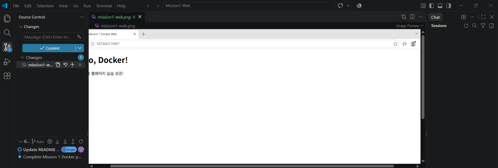

\# Mission 1 - Docker 개발 환경 구축 및 실습


\## 1. 실습 목표

\- 개발 도구 설치 및 버전 확인

\- PowerShell과 Ubuntu 파일 및 폴더 관리

\- Docker 이미지와 컨테이너 실행 및 관리

\- Docker로 웹페이지 실행

\- Bind Mount와 Volume을 이용한 데이터 공유 및 영속성 확인


\## 2. 개발 환경


| 도구 | 버전 |

|---|---|

| Docker | 29.9.2 |

| Git | 2.56.0.windows.4 |

| VS Code | 1.144.0 |

| PowerShell | 7.6.9 |

| WSL | 2 |

| Ubuntu | 24.04.5 LTS |

| 운영체제 | Windows 11 |

| 터미널/쉘 | PowerShell 7 / Ubuntu Bash |


\## 3. 실습 결과

\- Docker Hello World 실행 성공

\- Ubuntu 컨테이너 실행 및 파일 확인 성공

\- Nginx 웹페이지 빌드 및 접속 성공

\- Bind Mount 파일 변경 반영 확인

\- Volume 데이터 영속성 확인 성공

\### 미션 수행 체크리스트

\- \[x] Docker 및 Ubuntu 컨테이너 실습

\- \[x] Dockerfile 작성 및 커스텀 이미지 빌드

\- \[x] 포트 매핑 및 웹페이지 접속

\- \[x] Bind Mount 변경 반영

\- \[x] Volume 데이터 영속성 검증

\- \[x] Git 설정 및 GitHub 저장소 업로드


\## 4. Docker 기본 명령어

```bash

docker run hello-world

docker ps

docker ps -a

docker images


 docker logs mission1-ubuntu

docker inspect mission1-ubuntu

docker stats --no-stream mission1-ubuntu

docker start mission1-ubuntu

docker exec mission1-ubuntu cat /mission1-test/container-test.txt

docker stop mission1-ubuntu

docker --version

docker info 

```


\## 5. 웹페이지 Docker 실습

이미지 빌드 명령어:

docker build -t mission1-web .

컨테이너 실행 명령어:

docker run -d --name mission1-web-container -p 18881:80 mission1-web

브라우저 주소:

http://127.0.0.1:18881/


결과: Bind Mount Success! 웹페이지 표시 성공.


\### 커스텀 이미지 설명

\- 베이스 이미지: nginx:alpine

\- 커스텀 작업: 직접 작성한 index.html을 Nginx 웹 서버에 복사

\- 목적: 기본 Nginx 페이지 대신 직접 작성한 웹페이지를 표시.


\## 6. Bind Mount 실습

호스트 파일을 컨테이너 내부에 연결하는 명령어:

$htmlPath = (Resolve-Path .\\index.html).Path

docker run -d --name mission1-bind-container -p 18882:80 --mount "type=bind,source=$htmlPath,target=/usr/share/nginx/html/index.html,readonly" nginx:alpine

브라우저 주소:

http://127.0.0.1:18882/


결과: 호스트에서 수정한 HTML 파일이 컨테이너에도 반영되는 것을 확인.


\### Bind Mount 변경 확인

\- 호스트의 index.html 파일을 수정하기 전 브라우저 화면을 확인

\- 호스트의 index.html 파일을 수정한 후 브라우저 화면이 변경되는 것을 확인

\- 컨테이너를 다시 만들지 않아도 변경 사항이 반영됨.


\## 7. Docker Volume 실습

docker volume create mission1-data

docker run --name mission1-volume-first -v mission1-data:/data ubuntu:24.04 bash -c "echo 'Volume persistence test!' > /data/volume-test.txt && cat /data/volume-test.txt"

docker rm mission1-volume-first

docker run --name mission1-volume-second -v mission1-data:/data ubuntu:24.04 cat /data/volume-test.txt

실행 결과:

Volume persistence test!


첫 번째 컨테이너를 삭제한 뒤 새 컨테이너에서도 기존 데이터가 유지되는 것을 확인.


\### Volume 실습 설명

\- Volume 이름: mission1-data

\- 연결 경로: 컨테이너 내부 /data

\- 목적: 컨테이너를 삭제해도 데이터를 유지하기 위해 사용

\- 검증: 새 컨테이너에서 기존 파일의 내용을 다시 확인.


\## 8. Bind Mount와 Volume의 차이

Bind Mount: 내 컴퓨터의 특정 파일이나 폴더를 컨테이너와 연결한다.

Volume: Docker가 관리하는 저장 공간으로, 컨테이너를 삭제해도 데이터가 유지된다.


\- Bind Mount 실습 경로: 호스트의 index.html → 컨테이너의 /usr/share/nginx/html/index.html

\- Volume 실습 이름: mission1-data → 컨테이너의 /data


\## 9. 문제 해결 기록


\### 문제 1: Windows 경로를 Bind Mount에 연결할 때 오류 발생

\- 원인 추측: Windows 경로를 Docker가 전달하는 과정에서 경로 형식에 문제가 발생한 것으로 추측

\- 확인 방법: 경로를 확인하고 Docker 실행 결과를 확인

\- 해결 방법: Resolve-Path로 절대 경로를 구하고 Docker의 --mount 옵션을 사용


\### 문제 2: 브라우저 접속 로그에 favicon.ico 404 오류 표시

\- 원인 추측: 웹페이지에 파비콘 파일이 없어서 발생한 것으로 추측

\- 확인 방법: 브라우저에서 웹페이지가 정상적으로 표시되는지 확인하고 Nginx 로그 확인

\- 해결 방법: 웹페이지 표시에는 영향이 없는 오류이므로 별도 수정 없이 진행


\## 10. 스크린샷


웹페이지 실행 화면을 캡처하여 `screenshots/mission1-web.png` 파일로 저장하였다.


\### 웹페이지 실행 결과

!\[웹페이지 실행 화면](screenshots/mission1-web.png)


\## 11. 파일 및 폴더 권한 실습


실습 경로:

\- Windows: C:\\Users\\User\\Mission1-Practice

\- Ubuntu: /home/user/mission1-practice


\### 파일 권한 변경

\- 대상 파일: sample.txt

\- 실행 명령어: chmod 600 sample.txt

\- 결과: 소유자에게 읽기 및 쓰기 권한 부여


\### 폴더 권한 변경

\- 대상 폴더: sample-folder

\- 실행 명령어: chmod 700 sample-folder

\- 결과: 소유자에게 읽기, 쓰기 및 실행 권한 부여


\## 12. 터미널 파일 및 폴더 관리 실습


\### PowerShell

\- 현재 위치 확인: pwd

\- 파일 및 폴더 목록 확인: ls

\- 폴더 이동: cd

\- 폴더 생성: mkdir

\- 파일 생성: New-Item

\- 파일 내용 확인: Get-Content

\- 파일 복사: Copy-Item

\- 파일 이동 및 이름 변경: Move-Item

\- 파일 삭제: Remove-Item


\### Ubuntu Bash

\- 현재 위치 확인: pwd

\- 파일 및 폴더 목록 확인: ls -la

\- 폴더 이동: cd

\- 폴더 생성: mkdir

\- 빈 파일 생성: touch

\- 파일 내용 확인: cat

\- 파일 복사: cp

\- 파일 이동 및 이름 변경: mv

\- 파일 삭제: rm


\## 13. Git 및 GitHub 실습


\### Git 사용자 설정

\- 사용자 이름: yuu7708

\- 기본 브랜치: main


\### GitHub 저장소

\- 저장소 이름: Mission1-Web

\- 저장소 주소: https://github.com/yuu7708/Mission1-Web

\- 저장소 공개 여부: Public


\### Git 주요 작업

\- Git 저장소 초기화

\- README.md, index.html, Dockerfile, 스크린샷 추가

\- 변경 사항 커밋

\- 기본 브랜치를 main으로 변경

\- GitHub 원격 저장소 연결

\- GitHub에 파일 업로드(push)


\### 주요 명령어

```bash

git init

git config --global user.name "yuu7708"

git config --global user.email "개인이메일은 비공개"

git add .

git commit -m "Complete Mission 1 Docker practice"

git branch -M main

git remote add origin https://github.com/yuu7708/Mission1-Web.git

git push -u origin main

```


\### Git 설정 확인 결과

\- git config --list 명령어로 Git 설정 확인

\- 사용자 이름과 이메일 설정 확인

\- GitHub 원격 저장소(origin) 연결 확인

\- 현재 저장소 브랜치가 main으로 설정된 것을 확인

\- GitHub 저장소와 정상적으로 연결된 것을 확인


\### Docker 정보 확인 결과


실행 명령어:

docker info


확인 결과:

\- Docker Client 버전: 29.9.2

\- Docker Server 버전: 29.9.2

\- 실행 환경: Docker Desktop

\- 운영체제 유형: Linux

\- 아키텍처: x86\_64

\- CPU: 8개

\- 메모리: 약 7.605GiB

\- 컨테이너: 총 6개 (실행 중 2개, 중지 4개)

\- 이미지: 5개

\- Storage Driver: overlayfs


결과: Docker Client와 Server 정보를 정상적으로 확인하였다.


\### Docker 컨테이너 목록 확인 결과


실행 명령어:

docker ps -a


확인 결과:

\- 전체 컨테이너: 6개

\- 실행 중인 컨테이너: 2개

\- 중지된 컨테이너: 4개

\- mission1-web-container: 실행 중, 포트 18881 연결

\- mission1-bind-container: 실행 중, 포트 18882 연결

\- mission1-volume-second: 정상 종료 (Exit 0)

\- mission1-ubuntu: 종료 상태

\- hello-world: 정상 종료 (Exit 0)

\- welcome-to-docker: 종료 상태

결과: 컨테이너의 실행 및 종료 상태와 포트 연결을 확인하였다.


\### Docker 이미지 목록 확인 결과


실행 명령어:

docker images


확인 결과:

\- 전체 이미지: 5개

\- mission1-web: 직접 작성한 Dockerfile로 빌드한 이미지

\- nginx:alpine: 웹 서버 베이스 이미지

\- ubuntu:24.04: Ubuntu 실습 이미지

\- hello-world: Docker 실행 확인 이미지

\- docker/welcome-to-docker: 기존 Docker 이미지


결과: Docker 이미지 목록과 직접 빌드한 커스텀 이미지를 확인하였다.


\### Docker 컨테이너 로그 확인 결과


실행 명령어:

docker logs mission1-web-container


확인 결과:

\- Nginx 웹 서버 정상 시작

\- GET / 요청: HTTP 200 (정상 응답)

\- GET / 요청: HTTP 304 (캐시 사용)

\- favicon.ico 요청: HTTP 404 (파비콘 파일 없음)

\- 웹페이지는 정상적으로 표시됨


결과: Docker 컨테이너 로그를 통해 웹 서버의 시작 상태와 브라우저 요청 결과를 확인하였다.


\### Docker 컨테이너 리소스 사용량 확인 결과


실행 명령어:

docker stats --no-stream mission1-web-container


확인 결과:

\- 컨테이너 이름: mission1-web-container

\- CPU 사용량: 0.00%

\- 메모리 사용량: 8.109MiB

\- 메모리 제한: 7.605GiB

\- 메모리 사용률: 0.10%

\- 실행 중인 프로세스: 9개


결과: docker stats 명령어로 컨테이너의 CPU와 메모리 사용량을 확인하였다.

## VS Code Git 연동 증거

VS Code에서 Git 확장을 활성화하고 Mission1-Web 저장소를 인식한 것을 확인했습니다.



## 파일 및 폴더 관리 실습 결과

### PowerShell (Windows)

실습 경로: `C:\Users\User\Mission1-Practice`

- `Get-Location` : 현재 위치 확인
- `Get-ChildItem -Force` : 숨김 파일을 포함한 목록 확인
- `Get-Content sample.txt` : 파일 내용 확인
- `Copy-Item` : 파일 복사
- `Rename-Item` : 파일 이름 변경
- `Move-Item` : 파일 이동
- `New-Item -ItemType Directory` : 폴더 생성
- `New-Item -ItemType File` : 빈 파일 생성
- `Remove-Item` : 파일 삭제
- 파일의 `Hidden` 속성을 설정하고 `-Force`로 확인

### Ubuntu (WSL)

실습 경로: `/home/user/mission1-practice`

- `pwd` : 현재 위치 확인
- `ls -la` : 숨김 파일을 포함한 목록 확인
- `cat sample.txt` : 파일 내용 확인
- `cp` : 파일 복사
- `mv` : 파일 이름 변경 및 이동
- `touch` : 빈 파일 생성
- `rm` : 파일 삭제
- `chmod 600 sample.txt` : 파일 권한 설정
- `chmod 700 sample-folder` : 폴더 권한 설정
- `chmod 644 sample.txt` : 파일 권한 변경 및 확인
- `chmod 755 sample-folder` : 폴더 권한 변경 및 확인

### 권한 확인 결과

| 대상 | 권한 | 의미 |
|---|---|---|
| sample.txt | 600 | 소유자만 읽기·쓰기 |
| sample-folder | 700 | 소유자만 읽기·쓰기·실행 |
| sample.txt | 644 | 소유자는 읽기·쓰기, 나머지는 읽기 |
| sample-folder | 755 | 소유자는 전체 권한, 나머지는 읽기·실행 |

### 파일 및 폴더 권한의 숫자 의미

Linux 권한은 읽기(r), 쓰기(w), 실행(x)을 숫자로 표현한다.

- r(읽기) = 4
- w(쓰기) = 2
- x(실행) = 1

권한 숫자는 각 권한 값을 더해서 표현한다.

- 600: 소유자만 읽기와 쓰기 가능
- 644: 소유자는 읽기와 쓰기, 나머지는 읽기 가능
- 700: 소유자만 읽기, 쓰기, 실행 가능
- 755: 소유자는 모든 권한, 나머지는 읽기와 실행 가능

### 절대 경로와 상대 경로의 차이

- 절대 경로: 최상위 위치부터 시작하여 파일이나 폴더의 위치를 전체 경로로 표시한다.
  - 예: `/home/user/mission1-practice/sample.txt`
- 상대 경로: 현재 작업 중인 위치를 기준으로 파일이나 폴더의 위치를 표시한다.
  - 예: `sample.txt`, `backup/sample-renamed.txt`

절대 경로는 현재 위치와 관계없이 같은 위치를 가리키며, 상대 경로는 현재 작업 위치에 따라 가리키는 대상이 달라진다.

### Docker 포트 매핑의 의미

Docker 컨테이너 내부의 웹 서버에 외부에서 접속하려면 포트 매핑이 필요하다.

실습에서는 다음 명령어를 사용했다.

`docker run -d --name mission1-web-container -p 18881:80 mission1-web`

- 호스트 포트 `18881`: 내 컴퓨터에서 접속하는 포트
- 컨테이너 포트 `80`: Nginx 웹 서버가 사용하는 포트
- 브라우저 접속 주소: `http://127.0.0.1:18881/`

포트 매핑을 통해 호스트의 18881번 포트로 들어온 요청이 컨테이너의 80번 포트로 전달되어 웹페이지를 볼 수 있다.

### Docker Volume의 데이터 영속성

Docker Volume은 컨테이너와 별도로 데이터를 저장하는 공간이다.

실습에서는 `mission1-data`라는 Volume을 생성하고 컨테이너의 `/data` 경로에 연결했다.

1. 첫 번째 컨테이너에서 `/data/volume-test.txt` 파일을 생성했다.
2. 첫 번째 컨테이너를 삭제했다.
3. 같은 Volume을 두 번째 컨테이너에 연결했다.
4. 파일을 다시 읽어 `Volume persistence test!`라는 내용이 유지되는 것을 확인했다.

확인 결과: 컨테이너를 삭제해도 Volume에 저장된 데이터는 유지된다.

